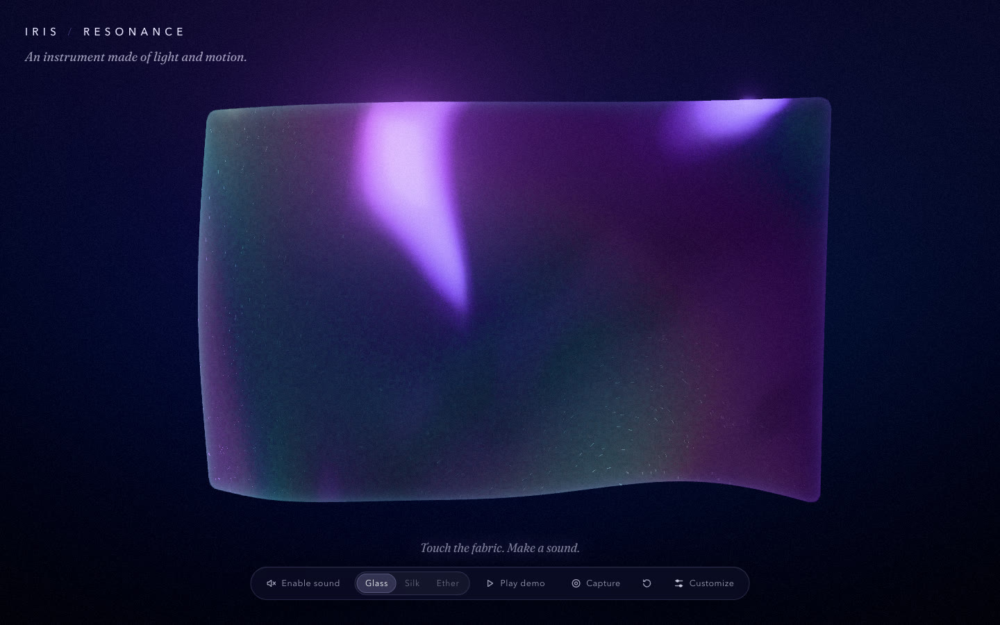
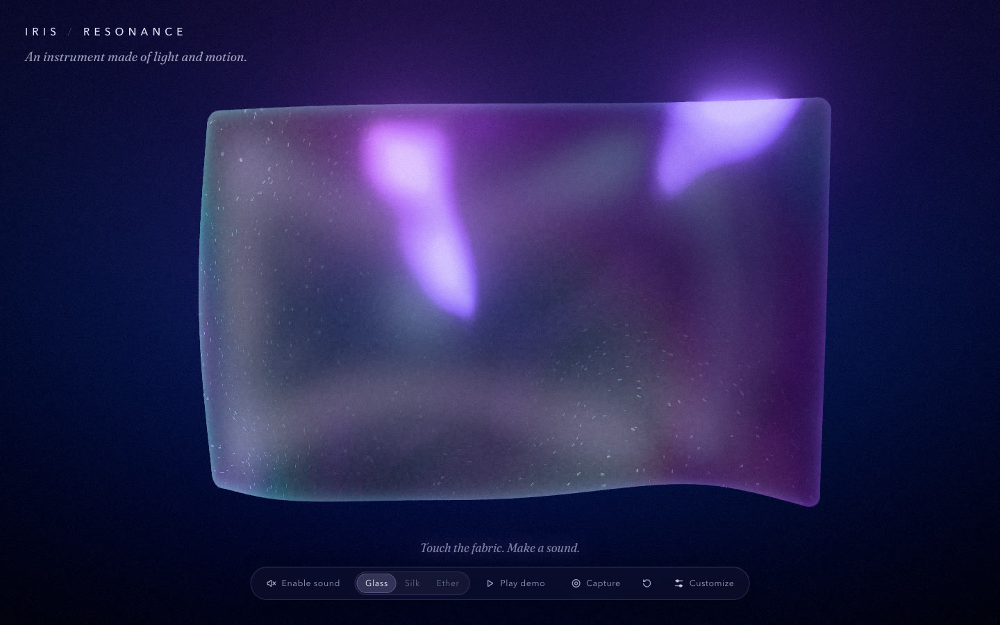
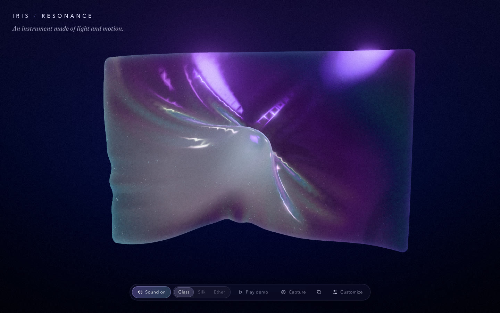
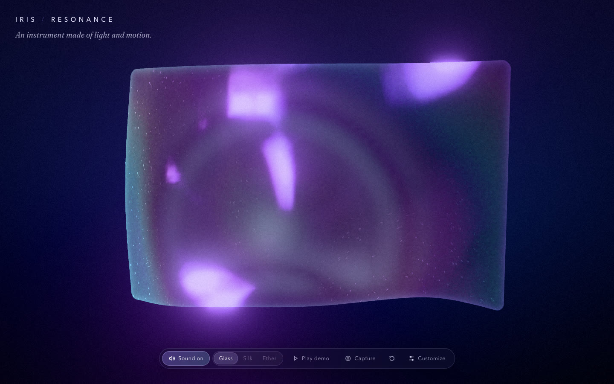

# Iris / Resonance

**An instrument made of light and motion.**

**Play it: [iris-resonance.vercel.app](https://iris-resonance.vercel.app)**

A single sheet of holographic fabric floats in the dark. Touch it and it sounds. Pluck it and a ripple runs across the membrane while a note rings. Grab it and pull, and the tone swells and bends as the fabric stretches. Sweep across it and it plays like a harp. The sound and the motion come from the same physical simulation. Nothing is pre-recorded.



| Pluck | Stretch | Release |
|---|---|---|
|  |  |  |

Listen to the three presets playing the showcase phrase, rendered offline through the real audio graph in Chrome: [Glass](docs/audio/glass.m4a) · [Silk](docs/audio/silk.m4a) · [Ether](docs/audio/ether.m4a).

## Playing it

| Gesture | What happens |
|---|---|
| **Click / tap** the fabric | A local pluck: a real impulse ripples through the mesh and a note sounds. Left → right climbs the scale; higher up is brighter. A quick jab (or firmer pen/touch pressure) plucks harder. |
| **Press and pull slowly** | The fabric sticks to your finger and stretches toward you. A sustained tone swells with the pull and bends up (at most two semitones) as the membrane tightens. |
| **Let go** of a stretch | The fabric snaps back, a ring travels across it, and a release note sounds. |
| **Sweep across** the fabric | The fabric slips under your finger (stick-slip friction), playing each region you cross, like a harp, with a gliding tone underneath. |
| Keys **A S D F G H J K L ; '** | Play the eleven regions left to right (hold **Shift** to play harder). |
| **C** / **Esc** | Clean view (hide the interface) / show it again, or stop the demo. |

The default scale is D minor pentatonic from D (Glass plays an octave up), so any combination of notes sounds consonant. The first touch on the fabric turns the sound on; the **Sound** button mirrors the real `AudioContext` state and mutes or unmutes.

**Controls:** Sound · Glass / Silk / Ether · Play demo · Capture (image, video, clean view) · Reset · Customize (Studio: scale, root, volume, reverb, attack, decay, tension, responsiveness, ringing, **fabric colour**, iridescence, background, reduced motion).

**Fabric colour:** Studio → Light → Fabric colour offers six palettes (Iris, Pearl, Rose, Aurora, Ember, Ice) and a custom picker that builds a holographic palette around any colour. The pitch you play still tints it: low notes lean one way, high notes the other.

## Run it

Needs Node 20+.

```bash
npm install
```

```bash
npm run dev
```

Then open `http://localhost:5310`.

| Command | |
|---|---|
| `npm run build` | Typecheck + production build into `dist/` |
| `npm run preview` | Serve the production build on `:4199` |
| `npm test` | 52 Vitest unit tests (physics, mapping, gestures, offline audio) |
| `npm run test:e2e` | 19 Playwright tests × Chromium, Firefox and WebKit (see [docs/testing.md](docs/testing.md)) |
| `E2E_PROD=1 npm run test:e2e` | The same against the local production bundle |
| `E2E_BASE_URL=https://iris-resonance.vercel.app npm run test:e2e` | The same against the live site |
| `npm run samples` | Render preset audio samples in Chrome (dev server running) |
| `npm run to-mp4 -- file.webm` | Convert a recording to an X-ready MP4 |

## Capture for X / a portfolio

- **Save image:** a high-resolution PNG of the WebGL scene only, with no interface, rendered at 2–4× the window (the long side is at least 3200 px for typical windows).
- **Record video:** records the canvas plus the instrument's own audio (routed through a `MediaStreamAudioDestinationNode`) with `MediaRecorder`. The format is detected at runtime (WebM VP9/Opus in Chrome, WebM VP8/Opus in Firefox, MP4 H.264/AAC in Safari), and the file extension always matches what the browser produced. If audio isn't available, the UI says "video only" rather than saving a silent file without telling you. Play while it records (the demo works well), then **Stop & save**.
- **MP4 for X:** `npm run to-mp4 -- iris-resonance-….webm` makes an H.264 High / AAC 48 kHz, constant 60 fps, fast-start MP4 (it uses the bundled `ffmpeg-static`).
- **Clean view** (`C`) hides the interface for screen recorders.

## Embed it in a portfolio

```html
<iframe
  src="https://iris-resonance.vercel.app/?embed=1"
  title="Iris / Resonance — a playable holographic membrane"
  style="width: 100%; aspect-ratio: 16 / 9; border: 0; border-radius: 16px;"
  allow="autoplay"
  loading="lazy"
></iframe>
```

Add `&fabric=rose` (any palette name) or `&fabric=%23ff8800` (any hex colour) to match your site's colours.

With `?embed=1` the title, presets and studio are hidden and the fabric fills the frame. A small sound button sits in the corner. **An embed never makes sound until that button is pressed**, even if the visitor touches the fabric. The mouse wheel is never captured, so the host page scrolls normally. Touches that start on the fabric play it; touches on empty space scroll the page.

## Deploy

Live at **https://iris-resonance.vercel.app** (Vercel project `iris-resonance`). `.env.production` sets `VITE_SITE_URL` to that origin so the Open Graph / X card image URL is absolute.

The GitHub repository is connected to Vercel, so every push to `main` deploys to production automatically (`npx vercel --prod` also works by hand). It's a static site. On **Vercel**, you can also import the repository (the included `vercel.json` sets the build to `npm run build` and the output to `dist/`), or from a terminal:

```bash
npx vercel --prod
```

Set `VITE_SITE_URL` to the deployed origin (Project → Settings → Environment Variables), so the Open Graph / X card image URL is absolute, and redeploy. Any static host works the same way: `npm run build` and serve `dist/`.

## How it works

- **Physics** (`src/physics/`): the Verlet cloth from Iris Cloth (structural / shear / bend constraints, weighted grab, fixed substeps), turned into a tensioned membrane with a sculpted rest pose, a home spring, and runaway guards. A 2D damped wave equation carries the fast ripples. The rendered surface is the cloth plus wave displacement along its normals, so every ripple you see is simulation state.
- **Gestures** (`src/interaction/gestureController.ts`): the single path from a contact to a physical force, musical events, and visual signals. Pointer, keyboard and the showcase all call it.
- **Audio** (`src/audio/`): Web Audio only. FM-pair plucks with shimmer partials and a noise "touch", a bowed sustain voice, a sympathetic resonance driven by measured membrane energy, convolution reverb, delay, a compressor and a soft clipper. Voices are capped, stolen and cleaned up.
- **Rendering** (`src/rendering/`): Three.js with the Iris Cloth holographic shader, extended with per-vertex vibration and strain, a touch halo and pitch-coupled colour; bloom and grain.

See [docs/architecture.md](docs/architecture.md), [docs/sound-design.md](docs/sound-design.md) and [docs/testing.md](docs/testing.md).

## Credits

**Iris / Resonance** by [Maria Showalter](https://github.com/Mariaareadne1) grows out of [Iris](https://github.com/Mariaareadne1/iris-cloth), her adaptation of the open-source **[Holocloth](https://github.com/dmitrykurash/holocloth)** by [Dmitry Kurash](https://x.com/DmitryKurash). The Verlet cloth solver, the holographic diffraction shader, the grain roughness texture and the film-grain pass are adapted from that work under the MIT License (see [LICENSE](LICENSE)).

Built with [Three.js](https://threejs.org), [React](https://react.dev) and [Vite](https://vite.dev). Subtitle type is [Fraunces](https://github.com/undercasetype/Fraunces) by Undercase Type (SIL Open Font License 1.1). Third-party notices: [THIRD_PARTY_NOTICES.md](THIRD_PARTY_NOTICES.md).
